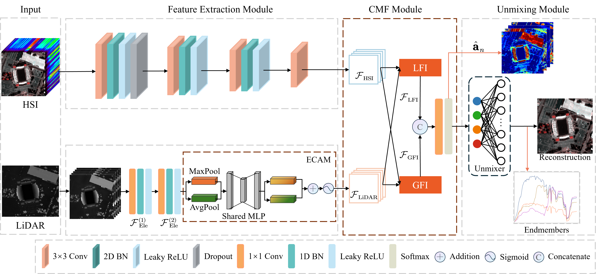

# MSSF-Net: A Multimodal Spectral-Spatial Feature Fusion Network  for Hyperspectral Unmixing
**Wei Gao, Yu Zhang, Youssef Akoudad, Jie Chen**

---

## 1. Abstract

*Below is the abstract from our paper:*

> Hyperspectral unmixing (HU) aims to decompose mixed pixels in remote sensing imagery into material-specific spectra and their respective abundance fractions. Recently, autoencoders have made significant advances in HU due to their strong representational capabilities and ease of implementation. However, relying exclusively on feature extraction from a single-modality hyperspectral image can fail to fully utilize both spatial and spectral information, thereby limiting the ability to distinguish objects in complex scenes. To address these limitations, we propose a multimodal spectral-spatial feature fusion network (MSSF-Net) for enhanced HU. MSSF-Net adopts a dual-stream architecture to extract feature representations from complementary input modalities. Specifically, the hyperspectral subnetwork leverages a convolutional neural network (CNN) to capture spatial information, while the light detection and ranging (LiDAR) subnetwork incorporates an enhanced channel attention mechanism (ECAM) to capture the dynamic changes in spatial information across different channels. Furthermore, we introduce a cross-modal fusion (CMF) module that integrates spectral and spatial information across modalities, leading to more robust feature representations. Experimental results indicate that MSSF-Net significantly outperforms existing traditional and deep learning-based methods in terms of unmixing accuracy.

---

## 2. Overview

The overall framework of **MSSF-Net** is shown below:



The model includes:
- A HSI encoder
- A LiDAR encoder
- A cross-modal fusion module 
- A decoding module for abundance reconstruction  

---

## 3. Citation

If you find this repository helpful in your research, please cite our work:

**Text Format:**

W. Gao, Y. Zhang, Y. Akoudad and J. Chen, "MSSF-Net: A Multimodal Spectral–Spatial Feature Fusion Network for Hyperspectral Unmixing," in *IEEE Transactions on Geoscience and Remote Sensing*, vol. 63, pp. 1–15, 2025, Art no. 5511515, doi: 10.1109/TGRS.2025.3563647.

**BibTeX Format:**

```bibtex
@ARTICLE{MSSF-Net2025, 
  author={Gao, Wei and Zhang, Yu and Akoudad, Youssef and Chen, Jie},
  journal={IEEE Transactions on Geoscience and Remote Sensing}, 
  title={MSSF-Net: A Multimodal Spectral–Spatial Feature Fusion Network for Hyperspectral Unmixing}, 
  year={2025},
  volume={63},
  number={},
  pages={1-15},
  doi={10.1109/TGRS.2025.3563647}
}
```

## 4. Generate Attribute Profile

The attribute profiles for LiDAR is applied based on the research work of [Dr.Liao](https://telin.ugent.be/~wliao/Partial_Reconstruction/). How to use the code can refer to this
```matlab
num_scales = 2;
MPNeachpca = getmorphprofiles(DSM, 'euclidean', 'square', num_scales);
MPN = cat(3, MPNeachpca, DSM);
```

## 5. Contact Information
If you have any questions, feedback, or collaboration ideas, feel free to reach out:

📧 2212308034@ujs.edu.cn
📧 octopusyyuu@gmail.com
